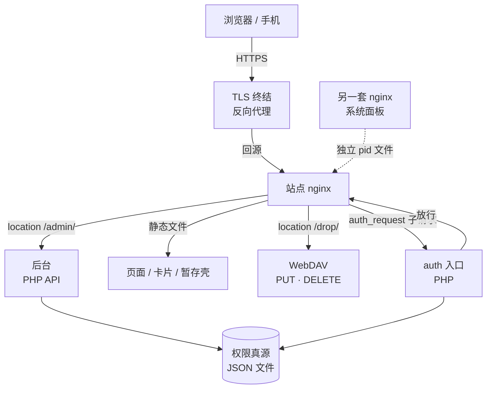
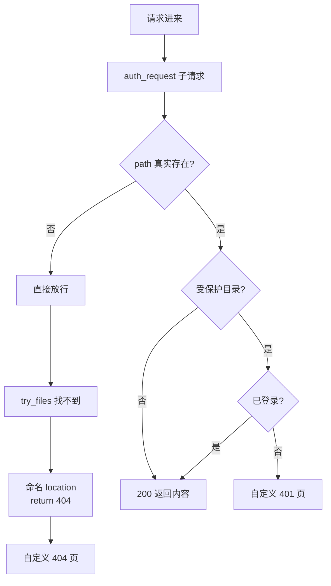
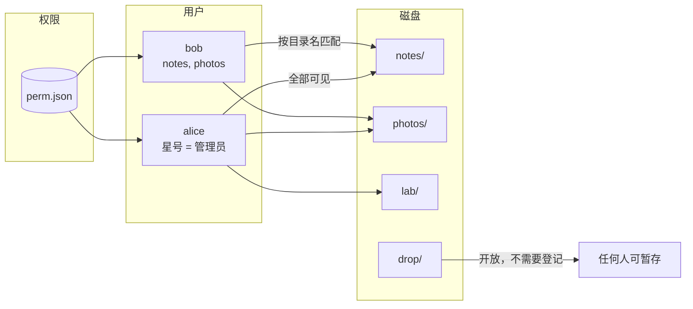
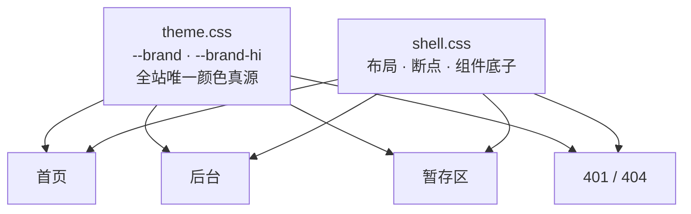

<h1 align="center">Homestead（自家院子）</h1>

<p align="center">
  <b>把散落在 NAS 上的十几个自建页面，收进一个要登录才能进的院子</b><br/>
  一张卡片墙 · 权限写在文件夹上 · 未登录也能暂存 · 手机和桌面同一套代码
</p>

<p align="center">
  <a href="#能做什么">能做什么</a> ·
  <a href="#架构">架构</a> ·
  <a href="#组件清单">组件</a> ·
  <a href="#三个结论">三个结论</a> ·
  <a href="#快速开始">快速开始</a> ·
  <a href="JOURNEY.md">心路历程</a>
</p>

---

## 能做什么

**一句话：给自己在 NAS 上攒下的那一堆小页面，做一个有门槛的入口。**

这些页面是一年年长出来的——一个博客、几个专题页、给家里人做的纪念页、放文件和图的临时区。它们各自能跑，但合起来没有"入口"这回事：地址要记十几个，谁能看哪一个说不清，外人误打误撞进来直接就看到内容。

Homestead 要解决的就是这件事，拆成四条：

### 1. 一个入口，把十几个页面收进一张卡片墙

首页不再是一个网站，而是**一面卡片墙**。每张卡片对应服务器上一个真实目录，有标题、副标、标签。点进去是该页面本身，不是另开一个站。

卡片不是手写的清单——**读的是磁盘上的真实目录**。目录在，卡片就在；目录删了，卡片跟着消失。没有中间层要维护，也不用记得"加了页面要去改配置"。

### 2. 谁能看哪一页，写在文件夹上，不写在数据库里

权限的真源是一个 JSON 文件，结构只有一层：

```json
{
  "alice": ["*"],
  "bob":   ["notes", "photos"],
  "carol": []
}
```

key 是用户名，value 是他能进的目录名数组。

这里有个刻意的设计：**`["*"]` 同时表示"管理员"和"全部页面"**。不是两个字段，不是 `is_admin` 加 `dirs`。因为在这套系统里这两件事本来就是一件——能看全部页面的人，就是要管全部页面的人。

代价是一个管理员不能只被授权看部分页面。收益是权限模型只有一个维度，后台不需要维护"管理员但限制页面"这种组合状态，也没有"我明明是管理员怎么看不到这页"的歧义。**少一个字段，少一整类 bug。**

配套的几条硬规则在后端，不在前端：

- 目标账号是站点主账号 → 任何人对它的改密/改配置/删除，一律拒绝；
- 非主账号的管理员，动别的管理员 → 拒绝（管理员平级，谁也不管谁）；
- 主账号动别人 → 放行；
- 改自己的密码走独立入口，不受上面三条限制。

前端的灰按钮只是提示，真正的拦截在 `api.php` 里——手搓请求一样过不去。

### 3. 没登录也能进，只是只能放东西

有一个"临时暂存区"：往服务器扔文件、扔图、扔压缩包，回头再取。它对外是开放的，因为扔东西不需要身份。

但开放不等于裸奔：**上传和删除走 WebDAV，写在 nginx 里**，页面本身只是一层壳。没登录的人在首页点"暂存"，弹的是页内登录框，不是跳转到登录页——人还在原地，登录完接着干原来那件事，地址栏都不变。

真正直接敲 `/drop/` 进来的，才由 nginx 的 `401` 接住，落到自定义的 401 页。

### 4. 手机上像 App，桌面上像工作台

同一份 HTML 服务两种屏幕，没有两套代码，也没有 SSR 分叉。

- 手机上：卡片单列、弹层从底部升起、底部安全区留白、输入框 16px（低于这个值 iOS 会自动放大页面，用户会以为页面坏了）；
- 桌面上：三到四列网格、悬停浮起、更大的留白和更细的描边。

断点只有四个：`760`（表格→卡片）、`640`（多列→单列）、`560`（暂存区控件换行）、`380`（极小屏收边距）。**断点少是刻意的**——每多一个断点，就多一组"只有那个宽度才复现"的 bug。

---

## 架构

### 1. 请求拓扑



要点：**系统面板和站点是两个 nginx 进程**，各管各的端口，各有自己的 pid 文件。它们共用一个 pid 文件时会互相覆盖——`reload` 会发给错误的那个人，改完配置永远不生效。这件事踩了十七天才发现，写在 [JOURNEY.md](JOURNEY.md) 里。

### 2. 一次请求怎么走到 401 / 404 / 200



这张图是关键。顺序反了，整个站点的行为就反了：

**`auth_request` 在 server 级执行，比 `try_files` 早。** 所以默认情况下，随便敲一个不存在的地址，也是先问"你登录了吗"，再问"这个文件在不在"。结果就是——**不存在的地址返回 401 而不是 404**，用户看到的是登录框，而不是"这个页面不存在"。

修法不在 nginx 的 `try_files`，而在 auth 入口的第一行：**先 `realpath`，路径不存在就直接放行**，把"存不存在"的判断还给 `try_files`，让 nginx 正常出 404。

第二个坑：`try_files ... =404` **不触发 server 级的 `error_page 404`**。它返回的 404 是内部的，直接交给浏览器，自定义页根本不会出现。必须改成一个命名 location，在里面 `return 404`，才会走 `error_page`。

两个坑叠在一起的表现是："我配了自定义 404，但永远看不到它。"

### 3. 目录级 ACL 的数据模型



三条配套约束：

1. **目录名是唯一键**。卡片标题、副标这些展示信息跟着目录走，不单独存一份；
2. **开放目录恒勾选且不可取消**——它是公共入口，不该被某个人的配置关掉；
3. **管理员只显示"全部 N 个"**，不逐个列。列出来也没意义，反正一个都不能取消。

### 4. 前端分层与主题 token



颜色只有一个参数：

```css
:root {
  --brand: #7b7ae8;      /* 主色 */
  --brand-hi: #8f8ef0;   /* 悬停/高亮 */
}
```

之前不是这样——同一个紫色在五六个文件里以 `#7170ff`、`#828fff`、`#8b8cff`、`rgba(113,112,255)`、`rgba(130,143,255)` 五种形态出现，改一次要改九处，还总会漏一处。抽成 token 之后，调色只动一个值，全站跟着变。

调色本身也有个结论：**要"柔和"，降饱和度，别动色相**。把 `hsl(240, 100%, 72%)` 改成 `hsl(241, 72%, 69%)`——色相挪 1°，饱和度砍 28 点。看着还是那个紫，但不刺眼了。直接换一个相近的色号反而会跑偏。

---

## 组件清单

| 层 | 组件 | 职责 | 规模 |
|---|---|---|---|
| 入口 | 首页 | 卡片墙、搜索、标签筛选、用户卡、页内登录弹层 | 约 1,000 行 |
| 入口 | 暂存区 | 文件列表、类型筛选、拖放上传、WebDAV 删除 | 约 970 行 |
| 入口 | 后台 | 账号增删改、目录勾选、主题色、开放目录 | 约 1,900 行 |
| 后端 | auth 入口 | 会话校验、`realpath` 放行、401 兜底 | 约 18 KB |
| 后端 | 后台 API | 账号 CRUD、平级拦截、主账号保护、改密 | 约 34 KB |
| 静态 | shell.css | 布局、四个断点、组件底子 | 约 260 行 |
| 静态 | theme.css | 颜色 token（`--brand`） | 约 30 行 |
| 兜底 | 401 页 | 与主站同视觉的登录兜底页 | 约 150 行 |
| 兜底 | 404 页 | 与主站同视觉的"这个地址不存在" | 约 100 行 |
| 运维 | nginx 配置 | `auth_request`、`error_page`、WebDAV、`try_files` | — |
| 运维 | 部署脚本 | 站点 nginx 的 test / reload / status 专用入口 | 约 50 行 |

没有框架、没有构建、没有依赖链。纯 HTML + CSS + 原生 JS + PHP，打开就能改，改完刷新就是结果。这是刻意的——这类页面的生命周期是几年，谁也不想两年后为了改一个按钮去修 `node_modules`。

---

## 三个结论

部署一套这种东西，真正会咬人的不是功能，是下面三条。它们都是踩出来的，不是想出来的。

### 1. 权限判断必须在后端，前端只负责提示

前端把按钮变灰、把选项设成 `disabled`，都只是**体验**。真正的手搓请求、直接调接口、改 localStorage，前端一条都挡不住。

所以完整的做法是两层：前端 `disabled` 让人知道"点不了"，后端 403 让人知道"真点不了"。少任何一层都会出问题——只做后端，用户会反复点、反复失败；只做前端，等于没有权限。

### 2. 自定义错误页要处理"内部跳转不触发 error_page"

`try_files ... =404`、`rewrite`、`internal` 这类内部产生状态码的写法，**不会**让 `error_page` 生效。想让自定义页出现，必须走"命名 location + `return`"这条路。

同理，`error_page` 是内部跳转，地址栏不变——这对 401 恰好是好事（登录完还在原地），对 404 是坏事（用户不知道自己在哪个地址）——所以在 404 页里给出"回首页"按钮比什么都重要。

### 3. 两套 nginx 共用一个 pid 文件，等于没有 reload

如果机器上同时跑了系统面板的 nginx 和自己站点的 nginx，而两者都用默认的 `/run/nginx.pid`：

- 后启动的那个会把 pid 写进同一个文件；
- `systemctl reload nginx` 按文件里的 pid 发信号 → 发给错误的那个人；
- 站点的 master 进程可能几周都没收到过一次 HUP，你改的配置一直没生效；
- 更糟的是 `systemctl stop nginx` 会按 pid 去 TERM，可能把系统面板一起停掉。

修法不是合并（两套 nginx 编译的模块不一样，合并会丢功能），是**让它们各自认自己的 pid**：站点侧改 `nginx.conf` 的 `pid` 指令，systemd 的 unit 用 drop-in 精确覆盖 `PIDFile` 和 `ExecReload`。改完怎么验证？**比 worker 的 PID**：发 HUP 前后 worker 全换一批，说明信号真到了；一个都没变，说明还是发给别人了。`nginx -t` 通过只能证明语法对，证明不了生效。

---

## 快速开始

### 目录结构

```
site/
├── index.html            # 卡片墙
├── 401.html              # 未登录兜底
├── 404.html              # 不存在的地址
├── assets/
│   ├── shell.css         # 布局与断点
│   └── theme.css         # 颜色 token
├── .acl/                 # 权限与鉴权（需 nginx 可读）
│   ├── perm.json         #   { 用户名: [目录名...] }
│   ├── auth.php          #   会话校验 + realpath 放行
│   ├── api.php           #   后台 API
│   └── session.key       #   签名密钥（自行生成，不要提交）
├── admin/index.html      # 后台
├── drop/index.html       # 暂存区
├── notes/                # ← 以下都只是普通目录，卡片自动出现
├── photos/
└── lab/
```

### nginx 关键片段

```nginx
server {
    # 先让 auth 决定"要不要登录"，再让 try_files 决定"存不存在"
    auth_request /_auth;

    location = /_auth {
        internal;
        fastcgi_pass unix:/run/php/php-fpm.sock;   # 按实际 PHP 部署方式改
        include fastcgi_params;
        fastcgi_param SCRIPT_FILENAME /path/to/site/.acl/auth.php;
    }

    location / {
        try_files $uri $uri/ /index.html;
    }

    # 受保护目录
    location ~ ^/(notes|photos|lab)/ {
        auth_request /_auth;
        try_files $uri $uri/ =404;
    }

    # 暂存区：上传/删除走 WebDAV
    location /drop/ {
        dav_methods PUT DELETE;
        create_full_put_path on;
        dav_access user:rw group:r all:r;
    }

    # 自定义状态页（注意用命名 location，不然内部 404 不触发）
    error_page 401 /401.html;
    error_page 404 /404.html;
    location = /401.html { internal; }
    location = /404.html { internal; }

    location @notfound {
        return 404;
    }
}
```

### 三步上线

```bash
# 1. 生成会话密钥（放在 .acl/，权限 600，不要提交）
head -c 32 /dev/urandom | base64 > .acl/session.key
chmod 600 .acl/session.key

# 2. 写第一份权限文件
echo '{"alice": ["*"]}' > .acl/perm.json

# 3. 校验配置再 reload（用你给站点准备的那个专用入口）
nginx -t && nginx -s reload
```

---

## 文档

| 文件 | 内容 |
|---|---|
| [JOURNEY.md](JOURNEY.md) | 心路历程：为什么会做成这样，踩了哪些坑，哪些决定是反直觉的 |
| [docs/permission-model.md](docs/permission-model.md) | 权限模型详解：双语义、平级规则、边界情况 |
| [docs/routing-contract.md](docs/routing-contract.md) | 路由约定：什么情况下 200 / 401 / 404，以及为什么 |

## 脱敏说明

这个仓库是**从一台真实在跑的服务器上抽出来的**。抽出时做了这些处理：

- 所有真实域名、内网地址、端口 → 占位符（`your-domain.example.com`、`<PORT>`）；
- 真实用户名 → `alice` / `bob` / `carol`；
- 会话密钥、密码哈希、访问令牌 → 全部删除，不留样例值；
- **个人内容页面（纪念页、私人相册、日记等）一个都不在仓库里**，这里只有框架和机制。

因此它不能"克隆下来直接跑起来看到一模一样的效果"——它是一套**可照着搭的骨架 + 一份踩过的坑的说明书**。

## 许可证

[MIT](LICENSE)
